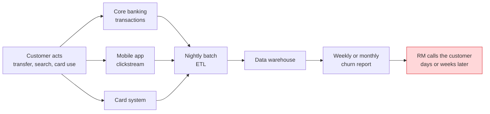
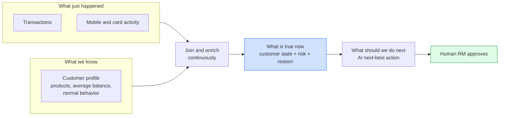
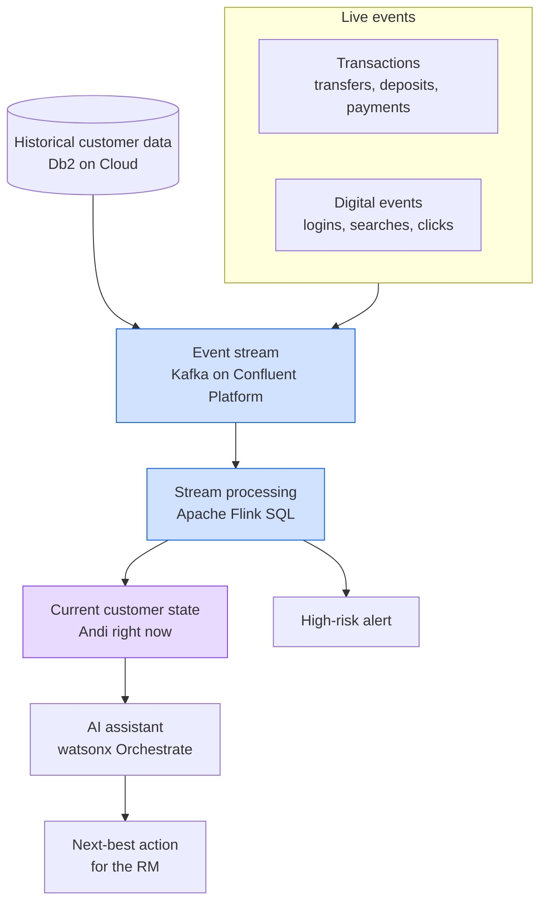
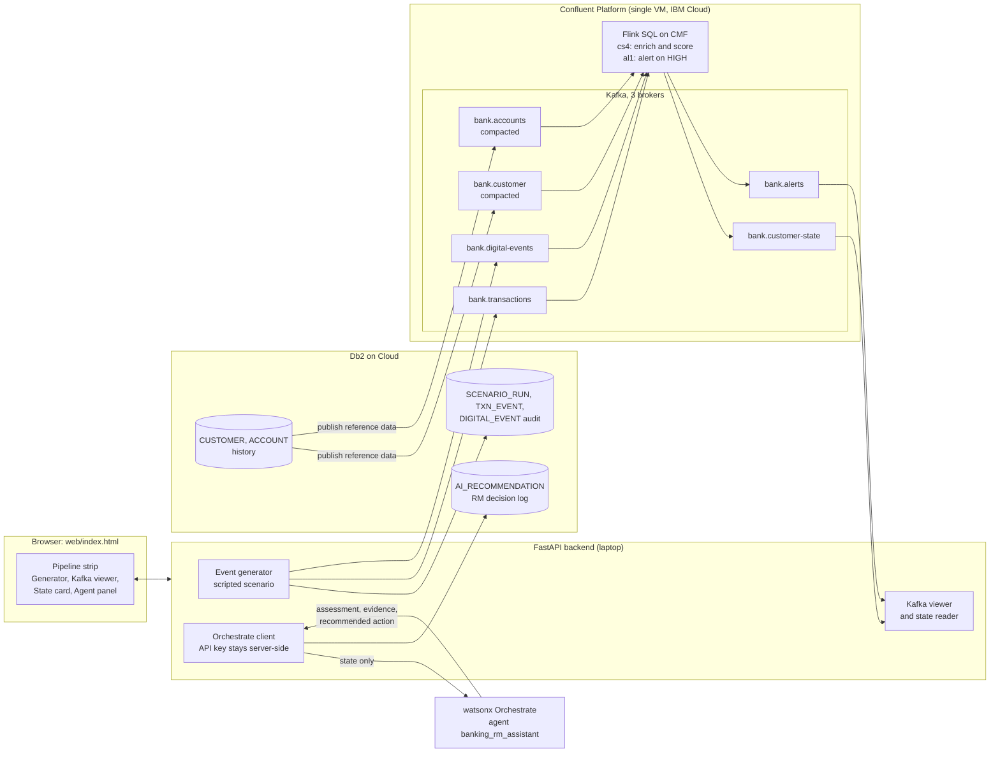
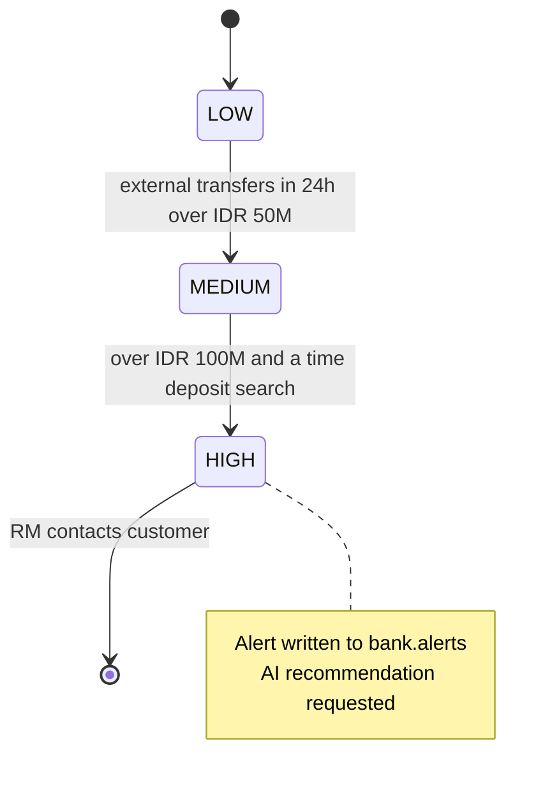

# Banking Streamhouse Demo: Storyline, Architecture and Talk Track

> **What we know + what just happened -> what is true now -> what should we do next.**

All customers, balances and events in this demo are synthetic. Risk thresholds are illustrative demo logic, not production policy. The AI is advisory: a human relationship manager (RM) approves any action.

---

## 1. The problem we are solving

### In one sentence

A bank knows a lot about its customers, but the knowledge is spread across systems and arrives late. When a customer starts moving money to another bank, the bank usually finds out after the money has gone.

### What happens today

Three things go wrong:

| Problem | What it looks like for Andi |
|---|---|
| **Data is siloed.** Transactions, app behavior and customer history live in different systems. | The IDR 80M transfer is in one system, the "time deposit rate" search is in another. Nobody sees both. |
| **Data is late.** Batch jobs report yesterday, not now. | By the time the report flags Andi, the money is already at another bank. |
| **Events are judged alone.** A single transfer or search looks normal. | IDR 80M out is unusual. A search is harmless. Only the combination, compared with Andi's normal behavior, is a signal. |

### Why it matters

A premium customer who moves funds away is a lost relationship. The bank's best chance to help is a conversation **while the behavior is happening**, not after.

### The question for the audience

> "How would your bank notice, within seconds, that a customer's behavior has changed, and give the RM the evidence and a suggested next step?"

---

## 2. How a streamhouse solves it

A streamhouse combines two things that are usually kept apart:

- **Streaming**: events as they happen (transactions, app activity).
- **Lakehouse and database history**: what we already know (profile, products, normal behavior).

A stream processor joins them continuously and keeps one always-current view of each customer: the **customer state**. An AI assistant reads that trusted state and recommends the next step.

| Without a streamhouse | With a streamhouse |
|---|---|
| Batch, hours to days old | Continuous, seconds |
| Events analyzed one by one | Events combined with history |
| A number in a report | A state with a reason and evidence |
| AI sees raw, stale or partial data | AI sees trusted, current context |
| Replaces nothing, adds a report | **Complements** the warehouse and core banking; it does not replace them |

---

## 3. Architecture

### 3.1 Concept (for executives)

### 3.2 What is actually deployed in this demo

Notes for the technical audience:

- **Db2 to Kafka.** Customer and account history is published to two compacted topics (`bank.customer`, `bank.accounts`) so Flink can join against it. In this demo an API call publishes it. In production the same job is done by a Kafka Connect JDBC or CDC source.
- **Flink SQL.** Statement `cs4` unions the two event topics, keeps a 24-hour window per customer, joins the history, and writes `bank.customer-state`. Statement `al1` writes `bank.alerts` when risk becomes HIGH. The SQL is shown in the page's "Flink SQL" tab and lives in [`flink/`](flink/).
- **AI.** Only the enriched state is sent to the agent, never raw events or credentials. Every recommendation and every RM decision is logged to Db2.
- **Governance.** Synthetic data, advisory output, human approval, full audit trail.

### 3.3 Risk logic (demo thresholds)

---

## 4. The story: Andi's day

**Andi** is a premium customer. Salary arrives monthly, he keeps about IDR 120M in savings, holds a mortgage and an investment account, uses his credit card and the mobile app often, and normally sends only about IDR 10M a month to other banks.

Each event on its own is unremarkable. Together they say: *Andi may be moving his money elsewhere.*

| # | Event | What the bank sees alone | What the streamhouse sees | Risk |
|---|---|---|---|---|
| 0 | Starting point | Healthy premium customer | Savings IDR 127M, 4 products, engagement high | LOW |
| 1 | **Salary +IDR 35M** | Normal deposit | Balance rises to IDR 162M. Nothing unusual. | LOW |
| 2 | **External transfer -IDR 80M** | "A large transfer" | 8x Andi's normal external transfers, balance down to IDR 82M | **MEDIUM** |
| 3 | **Mobile search: "time deposit rate"** | Harmless search | Context: Andi is comparing savings options while money leaves | MEDIUM |
| 4 | **External transfer -IDR 40M** | "Another transfer" | IDR 120M out in 24h, 12x normal, balance IDR 42M, plus the search | **HIGH** |
| 5 | Credit-card use declining | Slight dip | Supports the picture of reduced engagement | HIGH |

### The moment of insight

The streamhouse did not just move messages. At step 4 it **combined a new event with Andi's history** and produced a state with a reason:

> *External transfers exceed IDR 100M and the customer searched for time deposit rates.*

### The AI's role

The assistant reads that state and answers in a fixed format:

- **Assessment**: a significant change in behavior.
- **Evidence**: IDR 120M out versus a normal IDR 10M, balance IDR 42M versus a normal average of IDR 120M, the search, the card decline.
- **Recommended action**: the RM contacts Andi to understand his needs and discuss suitable deposit or investment options.

The RM presses **Approve** or **Dismiss**. Nothing is sent to the customer automatically. The decision is written to Db2.

---

## 5. Presenter talk track (about 7 minutes)

Open `http://localhost:8000/`. Press **Reset** before each run.

| Time | On screen | Say | Point to prove |
|---|---|---|---|
| 0:00 | Slide or this document, section 1 | "Banks hold rich data, but it is siloed and arrives in batches. By the time someone notices a pattern, the customer has already acted. How do you spot it while it is happening?" | The problem is **timeliness and context**, not lack of data. |
| 1:00 | Page header and **pipeline strip** | "Five stages: events, Kafka, Flink, customer state, AI. History from Db2 joins at the Flink stage." | One picture of the whole solution. |
| 1:45 | **Db2 history** tab, then the state card (LOW) | "This is what we already know about Andi. Healthy, premium, normal transfers about IDR 10M. Risk is low." | The history is the baseline that gives events meaning. |
| 2:30 | Click **Send next event** (salary) | "Salary arrives. The event goes to Kafka. Look at the `bank.transactions` tab: the raw record." Then show the state tab. | Events arrive as a stream. Normal event, still LOW. |
| 3:15 | Send **External transfer -80M** | "Now an IDR 80M transfer to another bank. The state updates and risk moves to MEDIUM. Flink compared the event with Andi's normal behavior." | Same event, different meaning because of history. |
| 4:00 | Send **Mobile search** | "A search for time deposit rates. On its own, nothing. But it adds digital context." | Digital and transaction data meet in one place. |
| 4:30 | Send **External transfer -40M**, then open **Flink SQL** tab | "Second transfer. IDR 120M left in a day. Risk is HIGH. The rule is plain SQL you can read here, and an alert lands on `bank.alerts`." | Transparent logic, a state with a reason, an alert. |
| 5:15 | Click **Ask agent for next-best action** | "Only this enriched state goes to the AI assistant, nothing raw. It explains the evidence and recommends an action." | AI is only as good as the context it is given. |
| 6:15 | Click **RM approves outreach** | "The AI advises, the human decides. Nothing is sent to Andi. The recommendation and the decision are logged." | Governance is built in. |
| 6:45 | Closing | See closing message below. | Takeaway. |

### Closing message

> A streamhouse turns disconnected live events into a continuously updated, trusted view of the customer. The AI assistant uses that context to recommend what the bank should do next, and a person decides.

---

## 6. What the audience should leave with

1. Customer events arrive continuously, not in nightly batches.
2. Events are combined with historical customer information.
3. The customer state changes within seconds.
4. The system explains **why** the behavior matters.
5. The AI recommends a reasonable, human-led action.
6. The streamhouse **complements** existing warehouses and core banking systems.

### Likely questions

| Question | Answer |
|---|---|
| Is this fraud detection or churn prediction? | Neither on its own. Version 1 shows one behavior change and one next step. Fraud, AML and credit scoring are out of scope. |
| Does the AI decide? | No. It recommends. An RM approves. It does not touch credit, pricing or regulatory decisions. |
| Are the thresholds real? | No. They are illustrative demo logic and must not be presented as production policy. |
| Does it replace our data warehouse? | No. The warehouse keeps history and reporting. The streamhouse adds the live layer on top. |
| Where does the history come from? | Db2. It is published to compacted Kafka topics so Flink can join it. In production, a Kafka Connect source keeps it in sync. |
| What if the AI service is down? | The page shows a clearly labelled simulated answer, so the audience is never misled. |
| Can we see the logic? | Yes. The Flink SQL is in the page and in the repo. |

---

## 7. Demo checklist

- [ ] Backend running: `./start-demo.sh`, then open `http://localhost:8000/`.
- [ ] Health shows Db2, Kafka and Orchestrate as connected (green dot in the AI panel).
- [ ] Flink statements `cs4` and `al1` are RUNNING.
- [ ] Press **Reset** once, confirm state shows LOW and savings IDR 127M.
- [ ] Dry run all five events. Expect LOW, MEDIUM, MEDIUM, HIGH, HIGH after the five events, with a final balance of IDR 42M.
- [ ] Have the recorded fallback ready in case of network trouble.
