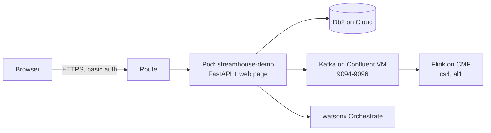

# Deploying the demo to OpenShift

The app runs as one pod (FastAPI backend plus the web page). It connects out to Db2 on Cloud, Kafka on the Confluent VM and watsonx Orchestrate. Flink runs on Confluent, not on OpenShift.



No secret is stored in this repository or in the image. Two Secrets are created in the cluster from local files.

## Prerequisites

- `oc` logged in to the cluster, with rights to create a project.
- The local files used by the backend: `.env.local`, the Db2 credentials JSON, the Orchestrate credentials JSON and `backend/certs/kafka-ca.crt` (see `.env.example`).
- Flink statements `cs4` and `al1` running on Confluent.

## 1. Create the project and Secrets

```bash
oc new-project streamhouse-demo

# Kafka settings and the login for the web page
oc create secret generic streamhouse-env \
  --from-literal=KAFKA_BOOTSTRAP='<vm-ip>:9094,<vm-ip>:9095,<vm-ip>:9096' \
  --from-literal=KAFKA_USERNAME='kafka-admin' \
  --from-literal=KAFKA_PASSWORD='<kafka-admin-password>' \
  --from-literal=DEMO_USER='demo' \
  --from-literal=DEMO_PASSWORD='<choose-a-password>'

# Credential files, mounted at /secrets
oc create secret generic streamhouse-files \
  --from-file=db2.json=<path-to-db2-credentials.json> \
  --from-file=orchestrate.json=<path-to-orchestrate-credentials.json> \
  --from-file=kafka-ca.crt=backend/certs/kafka-ca.crt
```

`DEMO_PASSWORD` turns on HTTP basic auth for everything except `/healthz`. Leave it out only for a private cluster.

## 2. Build the image in the cluster

The build uploads committed files only (`git archive`), so local credential files cannot end up in the image.

```bash
oc new-build --name=streamhouse-demo --binary --strategy=docker
oc patch bc/streamhouse-demo -p '{"spec":{"strategy":{"dockerStrategy":{"from":{"kind":"ImageStreamTag","namespace":"openshift","name":"python:3.11-ubi9"}}}}}'

git archive --format=tar HEAD > /tmp/src.tar
oc start-build streamhouse-demo --from-archive=/tmp/src.tar --follow
```

The `openshift/python:3.11-ubi9` tag is used because the cluster cannot pull `registry.redhat.io` directly.

## 3. Deploy

```bash
oc apply -f deploy/openshift.yaml
oc rollout status deploy/streamhouse-demo
oc get route streamhouse-demo -o jsonpath='https://{.spec.host}{"\n"}'
```

## 4. Check

```bash
curl -sk -o /dev/null -w "%{http_code}\n" https://<route>/            # 401 without login
curl -sk -u demo:<password> https://<route>/api/health               # db2, kafka, orchestrate all ok
```

Then open the route in a browser, log in, press **User guide** > **Check systems**, and press **Reset**.

## Update after a code change

```bash
git archive --format=tar HEAD > /tmp/src.tar
oc start-build streamhouse-demo --from-archive=/tmp/src.tar --follow
oc rollout restart deploy/streamhouse-demo
```

## Remove

```bash
oc delete project streamhouse-demo
```

## Notes

- The pod needs outbound access to Db2 (port 31249), the Confluent VM (ports 9094 to 9096) and the Orchestrate and IAM endpoints. This was confirmed on the TechZone cluster.
- Run one replica. Reset and the scenario run are shared state, and two pods would not change that, but the demo is designed for one presenter.
- If the Confluent VM IP changes, update `streamhouse-env` and run `oc rollout restart deploy/streamhouse-demo`.
