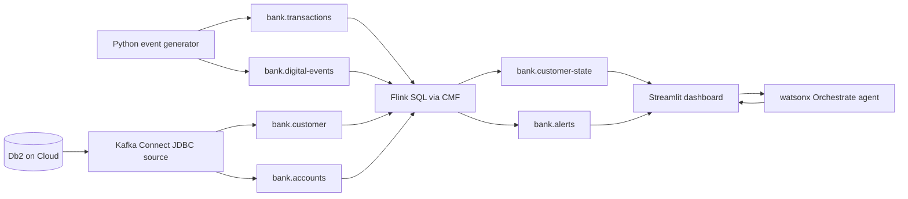

# Streamhouse Demo Implementation Plan (Db2 + Confluent + watsonx Orchestrate)

## Top-Level Overview

**Goal:** Implement the demo described in [`banking_streamhouse_demo_plan.md`](banking_streamhouse_demo_plan.md) using the environments the user already has:

| Role | Technology | Source of connection details |
|---|---|---|
| Historical customer data | IBM Db2 on Cloud | [`data (2).json`](data%20(2).json) |
| Event streaming, stream processing | Confluent Platform on a single VM: Kafka (3 brokers, SASL_SSL), Schema Registry, Kafka Connect, CMF + Apache Flink, Control Center | [`confluent.md`](confluent.md) |
| AI assistant (next-best action) | watsonx Orchestrate | [`ibm-credentials (3).env`](ibm-credentials%20(3).env) |
| Live dashboard | Streamlit (as in the original plan) | n/a |

**Scope:** One customer (Andi, `C001`), one behavior change, one updated customer state, one recommended action. All data is synthetic. AI output is advisory only with human approval.

**Approach (confirmed with the user):**
- Db2 is the system of record for profile, accounts and normal behavior.
- A Kafka Connect JDBC source connector copies Db2 tables into compacted Kafka topics (`bank.customer`, `bank.accounts`). If the JDBC connector and Db2 driver are not on the VM's Connect cluster, they are installed first.
- A Python generator publishes transaction and digital events to Kafka.
- Flink SQL (via CMF, pre-provisioned `flink-env` / `flink-catalog` / `flink-database` / `flink-compute-pool`) joins events with the Db2-derived topics, computes the indicators and risk, and writes `bank.customer-state` and `bank.alerts`.
- A watsonx Orchestrate agent receives only the enriched customer state and returns an explanation plus a recommended relationship-manager action.
- A Streamlit dashboard consumes `bank.customer-state` / `bank.alerts` and calls the Orchestrate agent.

**Data flow (for orientation, not part of the implementation):**

### Key facts grounded in the provided files

- **Confluent:** VM public IP, Control Center, Schema Registry, Connect, CMF endpoints and Kafka SASL_SSL broker ports 9094/9095/9096 with the `kafka-admin` account are documented in [`confluent.md`](confluent.md). The Kafka cluster starts empty and does not auto-create topics, so all `bank.*` topics must be created explicitly. The `kafka-ca.crt` must be downloaded via `scp` for native clients. Only `kafka-connect-datagen` is documented as pre-installed on Connect.
- **Db2:** [`data (2).json`](data%20(2).json) was a double-encoded JSON string and has been converted to a normal, pretty-printed JSON object (original backed up outside the repo at `/tmp/data_backup.json`). It has two top-level keys: `connection` and `instance_administration_api`. `connection.db2` gives database `bludb`, one host on port `31249`, direct username/password authentication, a `jdbc_url` of the form `jdbc:db2://<host>:31249/bludb:user=<userid>;password=<your_password>;sslConnection=true;` (user and password are placeholders, take them from `authentication`), and an embedded CA certificate (base64, name `2ce1ab40-7379-45d8-a40c-38dcafaf95d0`). `connection.cli` holds the same details in CLI form. `instance_administration_api` holds the CRN and the Db2 admin API root (`https://api.db2.cloud.ibm.com/v5/ibm`). The instance is an IBM Cloud Db2 on Cloud (`dashdb-for-transactions`, `us-south`) service.
- **Orchestrate:** [`ibm-credentials (3).env`](ibm-credentials%20(3).env) contains `ORCHESTRATE_APIKEY`, `ORCHESTRATE_IAM_APIKEY`, `ORCHESTRATE_URL` (region `jp-tok`, instance-scoped) and `ORCHESTRATE_AUTH_TYPE=iam`. No Orchestrate documentation library was available in the doc search tools, so the exact agent-creation and invocation mechanism (ADK CLI vs REST) must be verified during sub-task 6.
- **Balance arithmetic:** The original plan's "current balance IDR 42M" equals Savings 127M + 35M salary - 80M - 40M. The seed data must therefore start Andi's savings at IDR 127M, matching the `accounts.csv` example.

### Open items to resolve during implementation

1. Whether the Db2 instance (database `bludb`, confirmed from the converted file) accepts JDBC from the Confluent VM (network path) and from the laptop.
2. Whether a JDBC source connector plugin and the Db2 JDBC driver (`db2jcc4`) are installed on the Connect cluster; if not, how to install them on the VM (SSH as root is available).
3. Whether the CMF Flink image can read topics in the chosen serialization format; v1 default is JSON for events and Db2-sourced topics to avoid Avro schema-registry coupling, to be revisited only if Flink or Connect require Avro.
4. Orchestrate: whether the ADK (`orchestrate` CLI) can be used with this API key and instance URL, which LLM models the instance exposes, and the supported REST call to invoke an agent.
5. Reservation expires on November 20, 2026 (extend limit 2), so the environment is time-boxed and the demo reset must be repeatable.

### Security notes

- The three input files contain live credentials (Db2 password, Kafka and Control Center passwords, SSH private key, Orchestrate API key). The implementation must **not** copy secrets into code, the plan, logs or the dashboard. Credentials are read from a single git-ignored local config file created in sub-task 1 and loaded via environment variables.
- Add a `.gitignore` covering the three credential files, `confluent.md`, the local env file, `cflt-vsi-key.pem` and `kafka-ca.crt` if the folder is ever put under version control.
- `--ssl` is used for Db2 and SASL_SSL for Kafka; do not disable certificate verification in client code except where `confluent.md` itself uses `curl -k` for REST checks.

---

## Sub-Tasks

### Sub-Task 1: Environment readiness, connectivity checks and local configuration

- **Intent:** Prove that all three platforms are reachable from the working machine and centralize connection settings before building anything.
- **Expected Outcomes:**
  - A git-ignored local config file (for example `.env.local`) holds Confluent, Db2 and Orchestrate settings by variable name only, sourced from the three provided files.
  - `kafka-ca.crt` is downloaded locally.
  - Verified: Kafka metadata listing succeeds, Schema Registry / Connect / CMF REST respond, Db2 login succeeds, Orchestrate authenticates.
  - Open items 1, 2 and 4 are answered and recorded in this plan file's status notes.
- **Todo List:**
  1. Create the local config file and `.gitignore`.
  2. Download `kafka-ca.crt` using the `scp` command in [`confluent.md`](confluent.md) section 6.
  3. Check Kafka with `kcat -L`, and check `/sr/subjects`, `/connect/connectors`, `/connect/connector-plugins`, `/cmf/api/v1/environments` with curl.
  4. Verify a Db2 connection to `bludb` using the values in the now-converted [`data (2).json`](data%20(2).json) and the embedded CA certificate (extract it to a local file).
  5. Check Orchestrate: obtain an IAM token from the API key and make a trivial authenticated call against `ORCHESTRATE_URL`; determine whether the ADK CLI is usable.
  6. List installed Connect plugins and note whether a JDBC source and Db2 driver exist.
- **Relevant Context:** [`confluent.md`](confluent.md) sections 6.1-6.5; [`data (2).json`](data%20(2).json); [`ibm-credentials (3).env`](ibm-credentials%20(3).env).
- **Status:** `[x] done` in effect: Db2, Kafka (SASL_SSL), CMF/Flink and Orchestrate were each verified from the laptop while building the later sub-tasks.

### Sub-Task 2: Db2 schema and synthetic seed data

- **Intent:** Create the historical "what we know" layer in Db2 for the single fictional customer.
- **Expected Outcomes:**
  - `CUSTOMER` table with `customer_id, name, segment, avg_balance, normal_external_transfer, churn_risk` and one row for `C001` Andi (Premium, 120,000,000, 10,000,000, LOW). An additional `last_updated` timestamp column is needed so the JDBC connector can detect changes.
  - `ACCOUNTS` table with Savings 127,000,000, Credit Card 0, Mortgage -850,000,000, Investment 200,000,000.
  - Optionally, supporting columns for products owned (4) and engagement level (High), since the dashboard and initial state in the original plan display them.
  - A repeatable reset script restores the seed rows.
- **Todo List:**
  1. Define DDL and a seed/reset SQL script matching the original plan's `customer.csv` and `accounts.csv`.
  2. Run it against Db2 and verify with `SELECT`.
  3. Decide the primary key and incrementing/timestamp columns the connector will use.
- **Relevant Context:** Section 5.D of [`banking_streamhouse_demo_plan.md`](banking_streamhouse_demo_plan.md); Db2 doc library `docs_ibm_cloud_databases_for_db2_saas` if SQL or connection details need confirmation.
- **Status:** `[x] done` (tables created and seeded on the real Db2; see "Implementation notes" below)

**Implementation notes (Db2 tables, `backend/sql/schema.sql`, `backend/sql/seed.sql`):**

| Table | Purpose | Key columns |
|---|---|---|
| `CUSTOMER` | Historical profile and normal behavior (Kafka reference topic `bank.customer`) | PK `CUSTOMER_ID`; `AVG_BALANCE`, `NORMAL_EXTERNAL_TRANSFER`, `NORMAL_CARD_TXN_PER_WEEK`, `PRODUCTS_OWNED`, `ENGAGEMENT_LEVEL`, `CHURN_RISK`, `RELATIONSHIP_MANAGER`, `LAST_UPDATED` |
| `ACCOUNT` | Opening balances per product (reference topic `bank.accounts`) | PK `ACCOUNT_ID`; FK `CUSTOMER_ID`; `ACCOUNT_TYPE` (SAVINGS, CREDIT_CARD, MORTGAGE, INVESTMENT), `BALANCE`, `LAST_UPDATED` |
| `SCENARIO_RUN` | One row per demo run; tracks the next scripted step | PK `RUN_ID`; `STATUS`, `NEXT_STEP` |
| `TXN_EVENT` | Audit log of every generated transaction, with the Kafka partition/offset it was published to | PK `EVENT_ID`; FKs to customer, account, run; `DIRECTION`, `CHANNEL`, `AMOUNT` |
| `DIGITAL_EVENT` | Audit log of every generated digital event (searches, card-usage change) | PK `EVENT_ID`; `EVENT_TYPE`, `EVENT_TEXT`, `NUMERIC_VALUE` |
| `AI_RECOMMENDATION` | Governance log: state sent to the AI, its recommendation, and the relationship manager's decision | PK `RECOMMENDATION_ID`; `INPUT_STATE`, `RECOMMENDATION`, `RM_DECISION` |

- Design decisions: opening balances in `ACCOUNT` are never changed by the generator (Flink derives the current balance, expected IDR 42M after the story). Money is `DECIMAL(18,2)`. `CHECK` constraints restrict risk levels, directions and channels. Existing tables are left alone unless `drop_existing=true`.
- Db2 connection uses `ibm_db` with `SECURITY=SSL` and the CA certificate decoded from `data (2).json`. Verified: database `BLUDB`, schema `KCG18646`.

### Sub-Task 3: Kafka topics and Db2-to-Kafka ingestion via Kafka Connect

- **Intent:** Expose Db2 reference data as compacted Kafka topics so Flink can join events against it.
- **Expected Outcomes:**
  - Topics exist: `bank.transactions`, `bank.digital-events`, `bank.customer-state`, `bank.alerts`, plus compacted `bank.customer` and `bank.accounts`.
  - A JDBC source connector is running, and `bank.customer` / `bank.accounts` contain Andi's rows, keyed by `customer_id`.
  - New topics appear as tables in the Flink catalog (`SHOW TABLES;`).
- **Todo List:**
  1. Create topics explicitly (brokers do not auto-create).
  2. If the JDBC connector or Db2 driver is missing, install them on the VM through SSH, restart Connect, and re-check `/connect/connector-plugins`.
  3. Deploy the connector through the Connect REST API, using SSL to Db2 and the CA certificate; configure keys and compaction-friendly settings.
  4. Verify the topic contents with `kcat -C`.
- **Relevant Context:** [`confluent.md`](confluent.md) sections 5, 6.3, 6.5; Open items 2 and 3.
- **Status:** `[-] partly done`. Step 1 is done: the six `bank.*` topics were created through `POST /api/admin/topics` (3 partitions for event topics, 1 partition and `cleanup.policy=compact` for the two reference topics). Steps 2-4 (Connect JDBC connector, Db2 driver check) are still open. In the meantime `POST /api/admin/publish-reference-data` publishes `CUSTOMER` and `ACCOUNT` rows straight to the compacted topics as a fallback; it was verified for `C001`. Use either the connector or the fallback, not both.

### Sub-Task 4: Python event generator

- **Intent:** Produce the scripted behavior-change sequence, one event every few seconds.
- **Expected Outcomes:**
  - A script publishes, in order: salary +35M, external transfer -80M, mobile search "time deposit rate", external transfer -40M, and an optional declining credit-card event, with timestamps and `customer_id=C001`.
  - Transactions go to `bank.transactions`; the search event goes to `bank.digital-events`.
  - Configurable delay between events, and a dry-run/slow mode for rehearsal.
- **Todo List:**
  1. Define event schemas (field names consistent with what Flink will read).
  2. Implement the producer with SASL_SSL/PLAIN and the CA file.
  3. Add a "run next event" mode so the presenter can step through the story.
  4. Verify events with `kcat` and in Control Center.
- **Relevant Context:** Sections 2, 3 and 5.A of [`banking_streamhouse_demo_plan.md`](banking_streamhouse_demo_plan.md); [`confluent.md`](confluent.md) section 6.5.
- **Status:** `[x] done` as an API rather than a CLI script (see "Implementation notes" below). The remaining item, verification with Control Center, is left to the user.

**Implementation notes (generator API, `backend/`):**
- Run from the repo root: `python3 -m uvicorn backend.main:app --port 8000`. Interactive docs are served at `/docs`. Settings come from git-ignored `.env.local` and `data (2).json`; certificates are in git-ignored `backend/certs/`.
- Files: `config.py` (settings), `db.py` (Db2 access), `kafka_io.py` (topics, publish with delivery confirmation, tail), `generator.py` (scenario and events), `main.py` (FastAPI routes), `sql/schema.sql`, `sql/seed.sql`.
- Each generated event is written to Db2 (audit), published to Kafka keyed by `customer_id`, and the Kafka partition/offset is written back to the Db2 row.

| Method and path | What it does |
|---|---|
| `GET /api/health` | Reports Db2 and Kafka separately, including which `bank.*` topics exist |
| `POST /api/admin/schema?drop_existing=` | Create the demo tables |
| `POST /api/admin/seed` | Delete all demo data and load Andi and the four accounts |
| `POST /api/admin/topics` | Create the `bank.*` topics |
| `POST /api/admin/publish-reference-data` | Publish `CUSTOMER` and `ACCOUNT` to the compacted topics (fallback for Connect) |
| `POST /api/admin/reset` | Clear generated events and start a fresh run (does not purge Kafka) |
| `GET /api/customers`, `GET /api/customers/{id}` | Reference data with accounts |
| `GET /api/scenario/steps` | The five scripted steps |
| `POST /api/scenario/runs`, `GET /api/scenario/runs/latest`, `GET /api/scenario/runs/{id}` | Start and inspect a run |
| `POST /api/scenario/runs/{id}/next` | Generate the next scripted event |
| `POST /api/transactions`, `POST /api/digital-events` | Generate a custom event |
| `GET /api/transactions`, `GET /api/digital-events` | Audit rows from Db2, newest first |
| `GET /api/kafka/{topic}?limit=` | Read the latest records of a `bank.*` topic |
| `POST /api/recommendations`, `GET /api/recommendations`, `POST /api/recommendations/{id}/decision` | Log AI output and the RM's decision |

- Verified against the real Db2 and Kafka: the five-step run produced the expected records (salary 35M, transfers 80M and 40M, the product search, the card-usage change), a sixth step was rejected with HTTP 400, invalid input returned 422 and an unknown customer 404, records appeared in both Kafka and Db2 with matching offsets, and reset cleared Db2.
- Known limits: the Kafka viewer returns the latest records without live streaming (a server-sent-events endpoint is still part of sub-task 9a), event times use the server clock rather than the simulated 10:01-10:07 timeline, and the Kafka client skips broker hostname verification (`ssl.endpoint.identification.algorithm=none`) because the CA is checked but the broker certificates' names have not been confirmed. Event topics were purged after testing, but `reset` does not purge Kafka.

### Sub-Task 5: Flink SQL enrichment and risk scoring

- **Intent:** Combine events with Db2 history to maintain the current customer state and emit alerts, the core "streamhouse" value.
- **Expected Outcomes:**
  - Flink tables are defined over the `bank.*` topics (in `flink-env` / `flink-catalog` / `flink-database`).
  - A statement joins transactions and digital events by `customer_id` with the Db2-sourced customer and accounts data.
  - Computed fields: `current_balance`, `external_transfer_10m`, `external_transfer_24h`, `external_transfer_vs_normal`, `recent_product_search`, `credit_card_activity_change`, `customer_risk`, `risk_reason`.
  - Rules (illustrative): external transfers in 10 minutes above IDR 50M give MEDIUM; above IDR 100M with a recent "time deposit rate" search give HIGH. Resulting transitions: LOW (salary), MEDIUM (after the 80M transfer), HIGH (after the 40M transfer, total 120M).
  - Results written to `bank.customer-state`; a HIGH transition also writes to `bank.alerts` with the evidence.
- **Todo List:**
  1. Open the Flink SQL shell from the laptop using the command in [`confluent.md`](confluent.md) section 4.
  2. Define source tables, with event-time and watermarks on the events.
  3. Build the windowed or over-window aggregates and the join.
  4. Implement the risk CASE logic; label it clearly as demo logic.
  5. Define the sink tables and run the statement(s); validate the LOW -> MEDIUM -> HIGH sequence and the final balance of IDR 42M.
  6. Save the SQL as versioned scripts in the repo.
- **Relevant Context:** Section 6 of [`banking_streamhouse_demo_plan.md`](banking_streamhouse_demo_plan.md); [`confluent.md`](confluent.md) sections 4 and 6.4.
- **Status:** `[x] done`. `flink/01_customer_state.sql` (statement `cs4`) and `flink/02_alerts.sql` (statement `al1`) run on CMF. Verified LOW -> MEDIUM -> HIGH and a final savings balance of IDR 42M. See "Flink notes" below.

### Sub-Task 6: watsonx Orchestrate AI assistant

- **Intent:** Provide the "what should we do next" step by sending only the enriched customer state to an Orchestrate agent.
- **Expected Outcomes:**
  - An Orchestrate agent with the controlled instructions from section 5.F of the original plan (relationship-manager assistant; advisory only; explain evidence; no credit, pricing or regulatory decisions; no automatic customer contact).
  - A callable function (used by the dashboard) that takes a `bank.customer-state` / alert record and returns the explanation and recommended action, with the output logged.
  - For the Andi scenario the response matches the expected content: significant change, IDR 120M external transfers, declining balance, time-deposit search, notify the relationship manager.
- **Todo List:**
  1. Resolve Open item 4 (ADK vs REST; models available; authentication with IAM from the `.env` values).
  2. Create the agent (and any tool it needs) in the Orchestrate instance.
  3. Implement the invocation helper and pass only the whitelisted state fields.
  4. Test with a hand-built HIGH-risk state record before the pipeline is complete, then with the real record.
  5. Define a fallback (templated explanation) used if Orchestrate is unreachable during the demo.
- **Relevant Context:** [`ibm-credentials (3).env`](ibm-credentials%20(3).env); section 5.F and 10 of [`banking_streamhouse_demo_plan.md`](banking_streamhouse_demo_plan.md). Orchestrate docs were not found in the available documentation search libraries, so verify against the official Orchestrate documentation during this sub-task.
- **Status:** `[x] done`. Agent `banking_rm_assistant` (id `13b469a8-fbb7-4981-904d-479564c68e71`) is called through `backend/orchestrate.py`; the recommendation is logged to Db2 `AI_RECOMMENDATION`. The templated fallback is the labelled simulated answer in the web page.

### Sub-Task 7: Streamlit live dashboard

- **Intent:** Show the audience the continuously updated customer state, risk transitions and AI recommendation.
- **Expected Outcomes:**
  - Dashboard consumes `bank.customer-state` and `bank.alerts` and shows: current balance, average balance, external transfers (10 minutes / 24 hours), difference from normal, recent digital activity, engagement level, current risk, recommended action.
  - A timeline of incoming events and a risk-transition indicator (LOW -> MEDIUM -> HIGH).
  - An AI panel showing the Orchestrate response with evidence, plus an "RM approval" control (nothing is sent to the customer).
- **Todo List:**
  1. Implement a Kafka consumer with SASL_SSL for the state and alert topics.
  2. Build the layout for the fields above.
  3. Integrate the Orchestrate helper from sub-task 6 and the approval control.
  4. Add a live event feed and a "normal state" start view for Minute 2 of the demo.
- **Relevant Context:** Sections 5.E and 7 of [`banking_streamhouse_demo_plan.md`](banking_streamhouse_demo_plan.md).
- **Status:** `[ ] pending`

### Sub-Task 8: Governance, reset, rehearsal and fallback

- **Intent:** Make the demo repeatable and safe.
- **Expected Outcomes:**
  - One reset procedure returns Db2 seed data, Kafka topics (or consumer positions), and dashboard state to the initial Andi state.
  - Events, rules applied and AI output are logged.
  - A recorded fallback sequence exists.
  - UI and docs label the thresholds as demo logic, the data as synthetic, and the AI as advisory with human approval.
  - A written run sheet follows the five-minute demo flow.
- **Todo List:**
  1. Write the reset script (Db2 reset, clear or recreate `bank.*` topics, restart Flink statements).
  2. Run the full end-to-end rehearsal at least twice from a clean state.
  3. Record the fallback video or screenshots.
  4. Confirm the reservation end date and extension plan.
- **Relevant Context:** Sections 7, 8 (Phase 5), 10 and 11 of [`banking_streamhouse_demo_plan.md`](banking_streamhouse_demo_plan.md).
- **Status:** `[ ] pending`

---

### Sub-Task 9: Live process visualization web page (added on user request)

**Decisions confirmed with the user:**
- The page is **live from the start**: the generator publishes to real Kafka, and the data viewer reads real Kafka topics and Db2 through a small backend. Simulation mode is kept only as a fallback.
- The existing `ibm-credentials (3).env` API key is rejected by IBM IAM (`BXNIM0415E: Provided API key could not be found`). The user will generate a new key from the Orchestrate instance and update the `.env`. Nothing Orchestrate-related can be verified until then.

**Current state of the work (nothing has been run or tested yet):**
- `web/index.html` and `web/server.py` were drafted before planning was requested. They implement a simulation-only page plus an Orchestrate proxy. They are a starting point for the UI layout and the proxy, not a finished deliverable. The Orchestrate agent paths in `web/server.py` (`/v1/orchestrate/agents`, `/v1/orchestrate/{id}/chat/completions`) are assumptions and are not verified.

**Prerequisites (from earlier sub-tasks):**
- Sub-task 1 (connectivity, `kafka-ca.crt`, Db2 connection details, new Orchestrate key).
- Sub-task 2 (Db2 tables), sub-task 3 (topics, JDBC ingestion), sub-task 4 (generator logic) and sub-task 5 (Flink output topics).

#### 9a. Backend (live data bridge)

- **Intent:** Let the browser reach Kafka, Db2 and Orchestrate without exposing credentials.
- **Expected Outcomes:**
  - A backend reads all secrets from the git-ignored local config and never sends them to the browser.
  - `POST /api/generate/next` (and a reset) publishes the next scripted Andi event to the real Kafka topic.
  - A server-sent-events stream pushes new records from `bank.transactions`, `bank.digital-events`, `bank.customer-state` and `bank.alerts` to the page.
  - A read endpoint returns the Db2 `CUSTOMER` and `ACCOUNTS` rows.
  - Agent endpoints list Orchestrate agents and invoke the selected one, sending only the whitelisted customer-state fields.
  - `GET /api/status` reports the health of Kafka, Db2, Flink output and Orchestrate separately.
- **Todo List:**
  1. Choose the backend stack. The repo has no existing app code. Candidates are Python with FastAPI plus a Kafka client (consistent with the Python generator in sub-task 4) or the stdlib server already drafted.
  2. Reuse the generator logic from sub-task 4 rather than duplicating it.
  3. Implement Kafka SASL_SSL/PLAIN access with `kafka-ca.crt`, Db2 SSL access, and the IAM token exchange for Orchestrate.
  4. Replace the assumed Orchestrate paths with the ones verified in sub-task 6.
  5. Make failures visible per component instead of silently falling back.
- **Relevant Context:** [`confluent.md`](confluent.md) section 6.5; [`data (2).json`](data%20(2).json); [`ibm-credentials (3).env`](ibm-credentials%20(3).env); `web/server.py` draft.
- **Status:** `[x] done`. Orchestrate, customer-state, flink-sql and page-serving endpoints were added to the FastAPI backend (`web/server.py` was removed).

#### 9b. Front end (process visualization)

- **Intent:** Walk the audience through the pipeline: generator -> Kafka -> Db2 history -> Flink -> customer state -> Orchestrate agent.
- **Expected Outcomes:**
  - A pipeline strip whose stages light up when a real record arrives at that stage, with real counters.
  - Transaction generator panel: send next event, auto-play, reset.
  - Data viewer tabs: `bank.transactions`, `bank.digital-events`, Db2 history, Flink logic (SQL text), `bank.customer-state`, `bank.alerts`.
  - Customer state card with risk LOW -> MEDIUM -> HIGH, plus the evidence behind it.
  - AI agent panel: agent selector, "ask agent" button, response with source label, and a relationship-manager approve/dismiss control that sends nothing to the customer.
  - A visible Live / Simulation indicator. Simulation mode is a fallback with the same screens, labelled so the audience is never misled.
- **Todo List:**
  1. Reuse the layout and in-browser simulation from the `web/index.html` draft.
  2. Switch the data sources from local arrays to the backend's REST and SSE endpoints.
  3. Add per-component status indicators and a clearly labelled fallback.
  4. Include the disclaimers from section 10 of the original plan (synthetic data, demo thresholds, advisory AI, human approval).
- **Relevant Context:** Sections 2, 3, 5.E, 6 and 7 of [`banking_streamhouse_demo_plan.md`](banking_streamhouse_demo_plan.md); `web/index.html` draft.
- **Status:** `[x] done`. `web/index.html` is served at `http://localhost:8000/` and reads real Kafka, Db2 and Orchestrate data through the backend.

#### 9c. Verification

- **Intent:** Prove the page works against the real systems, not only in simulation.
- **Expected Outcomes:**
  - Pressing "send next event" four times produces the LOW -> MEDIUM -> HIGH sequence and a final balance of IDR 42M coming from Flink output, not browser code.
  - The agent response for the HIGH state matches the expected content in section 5.F of the original plan (external transfers of IDR 120M, time-deposit search, notify the relationship manager).
  - Killing Kafka or Orchestrate access shows a visible error or labelled fallback.
  - No secret appears in the page source, network responses or logs.
- **Todo List:**
  1. Run the full sequence after a reset.
  2. Test each failure mode.
  3. Inspect responses and logs for secrets.
  4. Record the confirmed Orchestrate API path in this file.
- **Status:** `[x] mostly done`. Full sequence after a reset verified through the page's endpoints; no secret found in the page or API responses. Not yet tested: killing Kafka/Orchestrate to see the failure display, and a visual browser pass.

## Suggested Order

Sub-tasks 1 -> 2 -> 3 -> 4 -> 5 -> 6 -> 7 -> 8. Sub-task 6 can start once Sub-task 1 has confirmed Orchestrate access with the new API key (a hand-built HIGH-risk state is enough to develop the agent); all others depend on their predecessors.

Sub-task 9 (9a -> 9b -> 9c) depends on sub-tasks 1-6. The UI layout in 9b can be refined against the simulation fallback while sub-tasks 3-5 are still in progress. Sub-task 9 does not replace sub-task 7: the user confirmed both are kept (Streamlit for the customer dashboard, the web page for the process walkthrough).

## Flink notes (confirmed during implementation)

- Catalog `bank-catalog` / database `bank-db` was created because the shipped `flink-catalog` could not read Schema Registry. The `bank.*` JSON topics are `(key VARBINARY, val VARBINARY)` tables and are parsed with `JSON_VALUE`.
- Both output tables use `changelog.mode=upsert`.
- The Kafka sink failed with "transaction timeout is larger than `transaction.max.timeout.ms`". Fixed with `ALTER TABLE ... SET ('kafka.producer.transaction.timeout.ms'='600000')` on `bank.customer-state` and `bank.alerts`.
- Statements must be submitted with `flinkConfiguration {"table.exec.source.idle-timeout": "1 s"}`. Without it, event partitions without data hold back the watermark and the join emits nothing.
- Thresholds use a 24-hour window per customer and run (demo logic, not production policy). The 10-minute window of the original plan was replaced because the scenario clock is real time and steps are seconds apart.
- Each customer-state record is keyed by `customer_id`; the page filters by `run_id`.

## How to run

1. `python3 -m uvicorn backend.main:app --port 8000` from the repo root, then open `http://localhost:8000/`.
2. Flink statements `cs4` and `al1` must be RUNNING in CMF (`GET /environments/flink-env/statements`).
3. "Reset" in the page clears Db2 events, starts a new run and republishes reference data. Kafka topics are not purged; the page filters by run.
